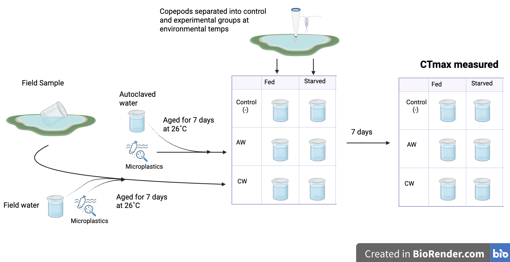

## Thesis Details

|                   |                              |
|------------------:|------------------------------|
|           Mentor: | Dr. Matthew Sasaki           |
| Committee Member: | Dr. Sarah Gignoux-Wolfsohn   |
|   Project Format: | Research Thesis              |
|   Project Output: | Article length written paper |

## Proposal Background

Microplastics are a growing concern in the world today. Microplastics are 5mm or less in size and vary in shape and in composition (e.g. polyethylene, polypropylene, etc). The amount of these microplastics has been increasing over the years (Reddy and Lau, 2020), but not much is known about their long term effects on living organisms. Microplastics have been observed to acquire microbial biofilms under natural conditions (Ballesté et al., 2024).

Copepods are small zooplankton are some of the most important organisms in the food chain as they consume phytoplankton and they themselves are a very abundant, protein rich food source for animals as small as fish larvae to whales. Given their important role in foodwebs, how copepods respond to increasing exposure to microplastics will have strong effects on the a large portion of the food web. Previous studies with marine copepods have shown a potential hormetic curve (small amount of toxin has positive effect) with their CTmax when consuming a small quantity of microplastics (Zhang et al., 2025). Other studies have also pointed out that copepods are able to detect microplastics and avoid them when feeding with a success rate of up to 80%, even in the presence of a biofilm (Xu et al., 2022). These dynamics and the effects of biofilms may, however, vary across species (Fagiano et al., 2025)

Starvation also has adverse effects on copepod thermal limits. In one marine species, for example, it has been found that starvation significantly lowers thermal limits (Moreno and Sasaki, 2023). The effect of particle aging and biofilm formation may also depend on the nutritional state of the copepod. Under low-food conditions, the presence of a biofilm may provide some nutritional benefit to grazers (Botterell et al., 2020), offsetting the effects of starvation. Alternatively, biofilms may reduce the selective feeding behaviour, thus increasing exposure to microplastics.

## Research Questions and Hypotheses

This research project will examine the effects of microplastic exposure on copepod physiology, and test whether these effects are altered by aging in environmental water samples (i.e. promoting the formation of a biofilm). For this research project we have three primary questions

**Question 1:** Does exposure to microplastics affect upper thermal limits in the freshwater copepod *Skistodiaptomus pallidus*?

> *Hypothesis 1*: Exposure to microplastics will decrease the thermal limits in the freshwater copepod *Skistodiaptomus pallidus.*

**Question 2:** Does the effect of microplastics on upper thermal limits differ between aged and un-aged microplastics?

> *Hypothesis 2*: The upper thermal limit for copepods exposed to aged microplastics will be higher than the upper thermal limit for those exposed to un-aged microplastics.

**Question 3:** Does microplastic aging alter the effect of starvation on upper thermal limits?

> *Hypothesis 3*: Because of the nutritional content of biofilms, starved copepods with aged microplastics will exhibit a smaller decrease in thermal limit relative to the control copepods, while starved copepods with un-aged microplastics will exhibit a sharp decrease in thermal limits.

## Experimental Design

### Hypothesis Testing

We will be using a mixed effects model to test our hypotheses. We are testing three hypotheses.

Hypothesis 1 will be comparing the fed control group to the fed un-aged microplastic group. We expect to see a decrease in CTmax for the fed un-aged microplastic group compared to the fed control group. Hypothesis 2 is comparing the fed un-aged microplastic group to the fed aged microplastic group. We expect to see a higher CTmax for the fed aged microplastic group compared to the fed un-aged microplastic group. Hypothesis 3 will be comparing both of the control groups, the starved un-aged microplastic group, and the starved aged microplastic group. We expect to see a smaller decrease in CTmax for the starved aged microplastic group relative to the fed control group, while the starved un-aged microplastics and the starved control group will see a sharper decrease in CTmax.



## Project Timeline

| Month | Progress |
|---:|----|
| September | Background reading, Planning, 1st experimental replicate |
| October | Experimental replicates, prepare poster on preliminary data |
| November | Final Experimental Replicates, Data analysis |
| December | Data analysis |
| January | Writing thesis |
| February | Writing thesis |
| March | Submit draft thesis to committee member, Prepare poster for student research and community engagement symposium |
| April | Writing thesis, Prepare final presentation for honors program |
| May |  |
