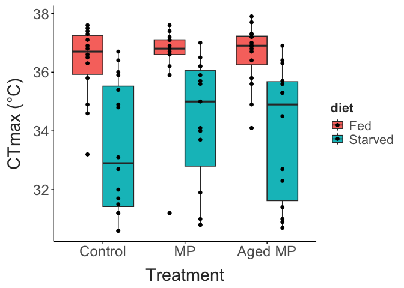
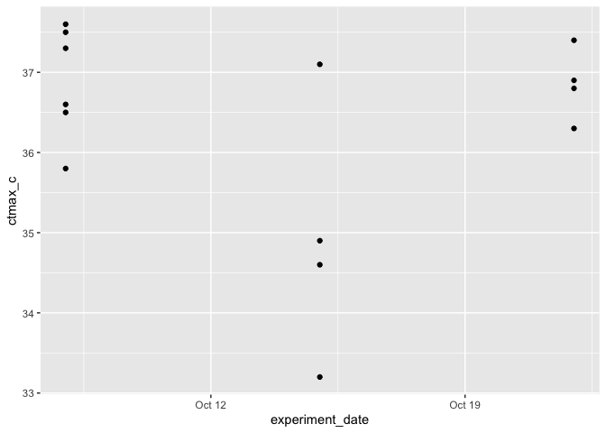

TITLE HERE
================
2026-10-27

- [Mortality Data](#mortality-data)
- [Thermal Limit Data](#thermal-limit-data)

## Mortality Data

``` r

surv_data |> 
  mutate(prop_mortality = num_dead /total) |> 
  ggplot(aes(x = MP_treatment, y = prop_mortality, fill = diet)) + 
  geom_boxplot(position = position_dodge(width = 0.85),
               outliers = F) + 
  geom_point(alpha = 0.5, position = position_dodge(width = 0.85)) + 
  labs(x = "Treatment", 
       y = "Mortality (proportion)") + 
  theme_matt_facets() + 
  theme(legend.position = "right")
```


``` r

# Example GLMM with binomial response and a random intercept for 'cluster_id'
model <- glmer(
  cbind(num_dead, total - num_dead) ~ MP_treatment * diet + (1 | exp_rep/treatment_rep),
  data = surv_data,
  family = binomial(link = "logit")
)
# View summary and fixed effect estimates (log-odds)
summary(model)
## Generalized linear mixed model fit by maximum likelihood (Laplace Approximation) ['glmerMod']
##  Family: binomial  ( logit )
## Formula: cbind(num_dead, total - num_dead) ~ MP_treatment * diet + (1 |  
##     exp_rep/treatment_rep)
##    Data: surv_data
## 
##      AIC      BIC   logLik deviance df.resid 
##    135.3    147.9    -59.6    119.3       28 
## 
## Scaled residuals: 
##      Min       1Q   Median       3Q      Max 
## -1.34086 -0.59326 -0.09651  0.31304  1.52780 
## 
## Random effects:
##  Groups                Name        Variance Std.Dev.
##  treatment_rep:exp_rep (Intercept) 0.09286  0.3047  
##  exp_rep               (Intercept) 0.74299  0.8620  
## Number of obs: 36, groups:  treatment_rep:exp_rep, 6; exp_rep, 3
## 
## Fixed effects:
##                                 Estimate Std. Error z value Pr(>|z|)    
## (Intercept)                      -1.8367     0.6398  -2.871  0.00410 ** 
## MP_treatmentMP                    1.1137     0.5022   2.217  0.02659 *  
## MP_treatmentAged MP               0.7904     0.4883   1.619  0.10548    
## dietStarved                       2.5248     0.5026   5.023 5.07e-07 ***
## MP_treatmentMP:dietStarved       -1.7496     0.6573  -2.662  0.00777 ** 
## MP_treatmentAged MP:dietStarved  -0.9845     0.6416  -1.534  0.12491    
## ---
## Signif. codes:  0 '***' 0.001 '**' 0.01 '*' 0.05 '.' 0.1 ' ' 1
## 
## Correlation of Fixed Effects:
##             (Intr) MP_tMP MP_tAMP dtStrv MP_MP:
## MP_trtmntMP -0.449                             
## MP_trtmnAMP -0.452  0.576                      
## dietStarved -0.468  0.587  0.583               
## MP_trtmMP:S  0.348 -0.770 -0.443  -0.747       
## MP_trtAMP:S  0.345 -0.441 -0.763  -0.743  0.566


# Perform omnibus test or pairwise comparisons across groups

car::Anova(model, type = "III") # Likelihood ratio or Wald tests
## Analysis of Deviance Table (Type III Wald chisquare tests)
## 
## Response: cbind(num_dead, total - num_dead)
##                     Chisq Df Pr(>Chisq)    
## (Intercept)        8.2407  1   0.004096 ** 
## MP_treatment       5.0922  2   0.078388 .  
## diet              25.2355  1  5.074e-07 ***
## MP_treatment:diet  7.0864  2   0.028921 *  
## ---
## Signif. codes:  0 '***' 0.001 '**' 0.01 '*' 0.05 '.' 0.1 ' ' 1

# Get estimated marginal means (proportions on the probability scale)
emmeans(model, ~ MP_treatment * diet, type = "response") |> plot()
```


## Thermal Limit Data

``` r

ctmax_data |> 
  ggplot(aes(x = MP_treatment, y = ctmax_c, fill = diet)) + 
  geom_boxplot(position = position_dodge(width = 0.75)) + 
  geom_point(position = position_dodge(width = 0.75)) + 
  labs(x = "Treatment", 
       y = "CTmax (°C)") + 
  theme_matt() + 
  theme(legend.position = "right")
```



``` r

ctmax_data |> 
  filter(group_id == "Control - Fed") |> 
  ggplot(aes(x = experiment_date, y = ctmax_c)) + 
  geom_point()
```



``` r

ctmax.model = lmer(data = ctmax_data, 
                   ctmax_c ~ MP_treatment * diet + (1|experiment_date/file_source))

car::Anova(ctmax.model, type = "III")
## Analysis of Deviance Table (Type III Wald chisquare tests)
## 
## Response: ctmax_c
##                       Chisq Df Pr(>Chisq)    
## (Intercept)       4467.7781  1  < 2.2e-16 ***
## MP_treatment         0.3186  2     0.8527    
## diet                22.9024  1  1.704e-06 ***
## MP_treatment:diet    0.8838  2     0.6428    
## ---
## Signif. codes:  0 '***' 0.001 '**' 0.01 '*' 0.05 '.' 0.1 ' ' 1
```
