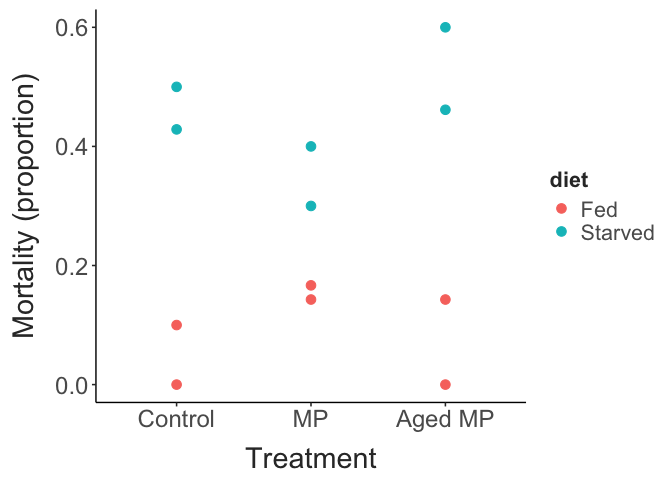
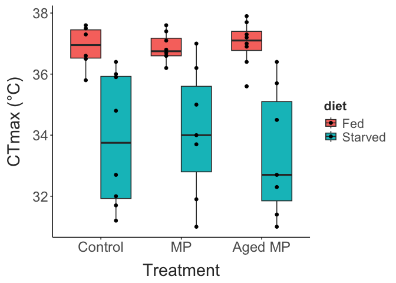

TITLE HERE
================
2026-10-09

``` r

surv_data |> 
  mutate(prop_mortality = num_dead /total) |> 
  ggplot(aes(x = MP_treatment, y = prop_mortality, colour = diet)) + 
  geom_point(size = 3) + 
  labs(x = "Treatment", 
       y = "Mortality (proportion)") + 
  theme_matt() + 
  theme(legend.position = "right")
```



``` r

ctmax_data |> 
  ggplot(aes(x = MP_treatment, y = ctmax_c, fill = diet)) + 
  geom_boxplot(position = position_dodge(width = 0.75)) + 
  geom_point(position = position_dodge(width = 0.75)) + 
  labs(x = "Treatment", 
       y = "CTmax (°C)") + 
  theme_matt() + 
  theme(legend.position = "right")
```



``` r

ctmax.model = lmer(data = ctmax_data, 
                   ctmax_c ~ MP_treatment * diet + (1|file_source))

car::Anova(ctmax.model, type = "III")
## Analysis of Deviance Table (Type III Wald chisquare tests)
## 
## Response: ctmax_c
##                       Chisq Df Pr(>Chisq)    
## (Intercept)       2702.6405  1  < 2.2e-16 ***
## MP_treatment         0.1157  2     0.9438    
## diet                15.1660  1  9.846e-05 ***
## MP_treatment:diet    0.4815  2     0.7861    
## ---
## Signif. codes:  0 '***' 0.001 '**' 0.01 '*' 0.05 '.' 0.1 ' ' 1
```
