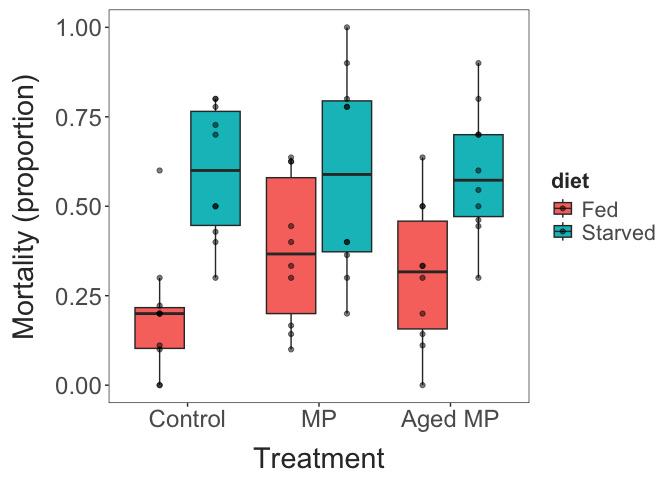
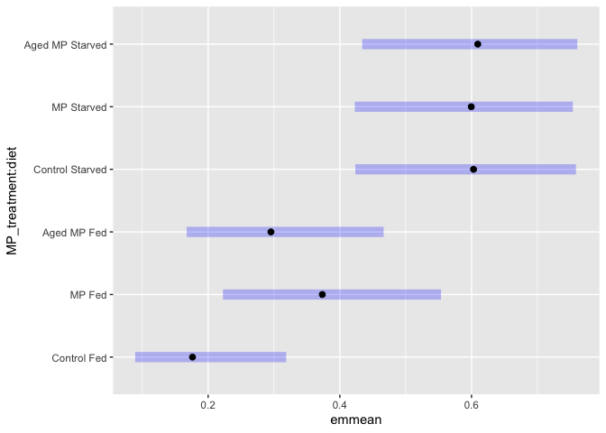
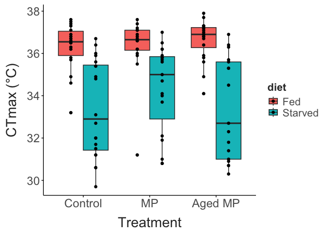
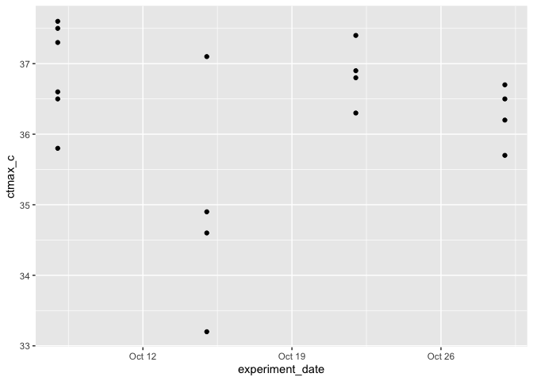

TITLE HERE
================
2026-11-05

- [Mortality Data](#mortality-data)
- [Thermal Limit Data](#thermal-limit-data)

## Mortality Data

``` r

surv_data |> 
  mutate(prop_mortality = num_dead /total) |> 
  ggplot(aes(x = MP_treatment, y = prop_mortality, fill = diet)) + 
  geom_boxplot(position = position_dodge(width = 0.85),
               outliers = F) + 
  geom_point(alpha = 0.5, position = position_dodge(width = 0.85)) + 
  labs(x = "Treatment", 
       y = "Mortality (proportion)") + 
  theme_matt_facets() + 
  theme(legend.position = "right")
```



``` r

# Example GLMM with binomial response and a random intercept for 'cluster_id'
model <- glmer(
  cbind(num_dead, total - num_dead) ~ MP_treatment * diet + (1 | exp_rep/treatment_rep),
  data = surv_data,
  family = binomial(link = "logit")
)
# View summary and fixed effect estimates (log-odds)
summary(model)
## Generalized linear mixed model fit by maximum likelihood (Laplace Approximation) ['glmerMod']
##  Family: binomial  ( logit )
## Formula: cbind(num_dead, total - num_dead) ~ MP_treatment * diet + (1 |      exp_rep/treatment_rep)
##    Data: surv_data
## 
##      AIC      BIC   logLik deviance df.resid 
##    228.7    245.5   -106.4    212.7       52 
## 
## Scaled residuals: 
##      Min       1Q   Median       3Q      Max 
## -2.05771 -0.58461  0.03687  0.55052  2.05460 
## 
## Random effects:
##  Groups                Name        Variance Std.Dev.
##  treatment_rep:exp_rep (Intercept) 0.05645  0.2376  
##  exp_rep               (Intercept) 0.40575  0.6370  
## Number of obs: 60, groups:  treatment_rep:exp_rep, 10; exp_rep, 5
## 
## Fixed effects:
##                                 Estimate Std. Error z value Pr(>|z|)    
## (Intercept)                      -1.5421     0.3988  -3.867  0.00011 ***
## MP_treatmentMP                    1.0243     0.3527   2.905  0.00368 ** 
## MP_treatmentAged MP               0.6724     0.3519   1.911  0.05600 .  
## dietStarved                       1.9602     0.3526   5.559 2.72e-08 ***
## MP_treatmentMP:dietStarved       -1.0387     0.4699  -2.210  0.02708 *  
## MP_treatmentAged MP:dietStarved  -0.6455     0.4677  -1.380  0.16747    
## ---
## Signif. codes:  0 '***' 0.001 '**' 0.01 '*' 0.05 '.' 0.1 ' ' 1
## 
## Correlation of Fixed Effects:
##             (Intr) MP_tMP MP_tAMP dtStrv MP_MP:
## MP_trtmntMP -0.510                             
## MP_trtmnAMP -0.506  0.572                      
## dietStarved -0.519  0.583  0.575               
## MP_trtmMP:S  0.382 -0.751 -0.430  -0.740       
## MP_trtAMP:S  0.380 -0.431 -0.753  -0.737  0.553


# Perform omnibus test or pairwise comparisons across groups

car::Anova(model, type = "III") # Likelihood ratio or Wald tests
## Analysis of Deviance Table (Type III Wald chisquare tests)
## 
## Response: cbind(num_dead, total - num_dead)
##                     Chisq Df Pr(>Chisq)    
## (Intercept)       14.9507  1  0.0001104 ***
## MP_treatment       8.5289  2  0.0140598 *  
## diet              30.8986  1  2.719e-08 ***
## MP_treatment:diet  4.9217  2  0.0853624 .  
## ---
## Signif. codes:  0 '***' 0.001 '**' 0.01 '*' 0.05 '.' 0.1 ' ' 1

# Get estimated marginal means (proportions on the probability scale)
emmeans(model, ~ MP_treatment * diet, type = "response") |> plot()
```



## Thermal Limit Data

``` r

ctmax_data |> 
  ggplot(aes(x = MP_treatment, y = ctmax_c, fill = diet)) + 
  geom_boxplot(position = position_dodge(width = 0.75)) + 
  geom_point(position = position_dodge(width = 0.75)) + 
  labs(x = "Treatment", 
       y = "CTmax (°C)") + 
  theme_matt() + 
  theme(legend.position = "right")
```



``` r

ctmax_data |> 
  filter(group_id == "Control - Fed") |> 
  ggplot(aes(x = experiment_date, y = ctmax_c)) + 
  geom_point()
```



``` r

ctmax.model = lmer(data = ctmax_data, 
                   ctmax_c ~ MP_treatment * diet + (1|experiment_date/file_source))

car::Anova(ctmax.model, type = "III")
## Analysis of Deviance Table (Type III Wald chisquare tests)
## 
## Response: ctmax_c
##                       Chisq Df Pr(>Chisq)    
## (Intercept)       6211.8752  1  < 2.2e-16 ***
## MP_treatment         0.5835  2      0.747    
## diet                29.7723  1  4.859e-08 ***
## MP_treatment:diet    2.9838  2      0.225    
## ---
## Signif. codes:  0 '***' 0.001 '**' 0.01 '*' 0.05 '.' 0.1 ' ' 1
```
